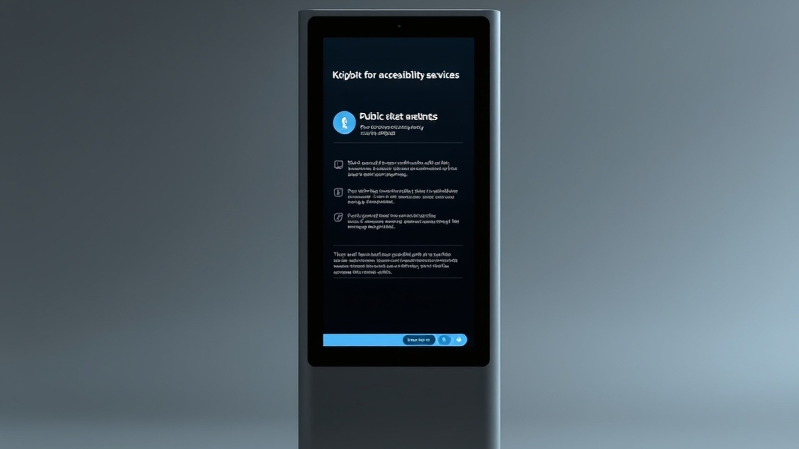

# imaa-kiosk (إيماء)

A bilingual, high-contrast, accessibility-first kiosk interface designed for real-time sign-language bridge services. Supports PSL/ArSL ↔ Arabic, English, and Urdu translations, specifically optimized for high-traffic government and health-care environments.



## Features

- **Accessibility-First UI:** Large touch targets, high-contrast visual elements, and screen-reader ready architecture.
- **Multi-lingual Support:** Seamless switching between Arabic, English, and Urdu.
- **Sign Language Integration:** Real-time interface for sign-language bridge services.
- **Kiosk-Ready:** Secure-by-default, dark-mode optimized, and minimized interaction overhead.

## Setup

This project uses modern web standards and is optimized for kiosk-mode deployment on standard kiosk hardware.

```bash
# Clone the repository
git clone https://github.com/Amz34/imaa-kiosk.git
cd imaa-kiosk

# Install dependencies
npm install

# Build for production
npm run build
```

## License

MIT
